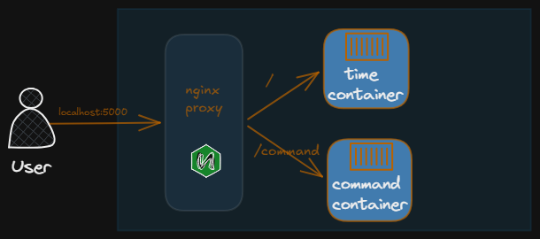

# Nginx Reverse Proxy Demo

This project runs two small static websites in separate Nginx containers and
uses a third Nginx container as a reverse proxy. Visit one local address to
reach either site:

- `/` serves the live local-time clock.
- `/command/` serves Shellwise, a searchable guide to common Linux commands.

## Architecture



The proxy listens on port `80` inside its container and is published as port
`5000` on the host. Requests to `/command` are redirected to `/command/`;
the proxy removes that prefix before forwarding the request to the command
website.

## Run the project

You need Docker with the Compose plugin installed and running.

From this directory, start the services:

```bash
docker compose up -d
```

Open the sites in a browser:

- Clock: <http://localhost:5000/>
- Linux command guide: <http://localhost:5000/command/>

To follow service logs:

```bash
docker compose logs -f
```

To stop and remove the containers and network:

```bash
docker compose down
```

## Project layout

```text
.
├── 1.png                 # Architecture diagram used above
├── compose.yml           # Proxy and website container definitions
├── config/
│   └── nginx.conf        # Reverse-proxy routes
├── web-1/
│   └── index.html        # Live clock website
└── web-2/
    └── index.html        # Linux command guide website
```

The Compose file mounts the website HTML and proxy configuration into their
containers. Edit those files and recreate or restart the relevant service to
apply changes.
